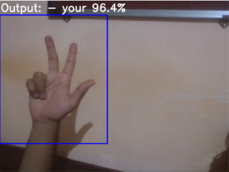
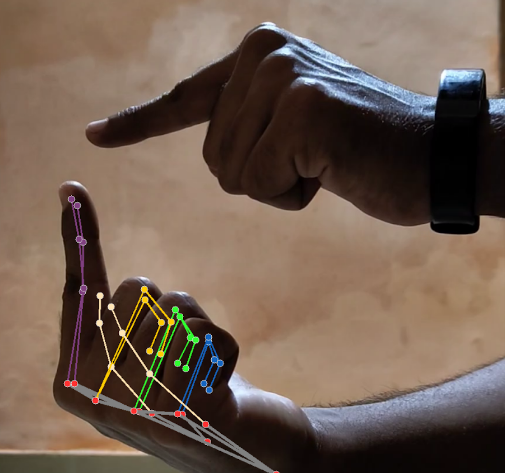

<h1 align="center">Sign Language Recognition</h1>

<p align="center"><strong>Reads Indian Sign Language words from a webcam, live, with MediaPipe hand landmarks and an LSTM.</strong></p>

<p align="center">
  <a href="https://github.com/Cl0ud-9/Sign-Language-Recognition/actions/workflows/ci.yml"></a>
  <a href="LICENSE"></a>
  
  
  <a href="https://www.kaggle.com/datasets/paragtonpe/sign-language-recognition-dataset"></a>
</p>

<p align="center">
  <a href="#quick-start">Quick start</a> &nbsp;·&nbsp;
  <a href="#the-dataset">The dataset</a> &nbsp;·&nbsp;
  <a href="#retrain-the-model">Retrain the model</a> &nbsp;·&nbsp;
  <a href="#results">Results</a> &nbsp;·&nbsp;
  <a href="#honest-limits">Honest limits</a>
</p>

<br>

<p align="center">
  
  &nbsp;
  
</p>

<p align="center"><sub>Left: the app recognising <b>your</b>, before the display was redesigned in 1.2.0. Right: MediaPipe's hand landmarks, the features the model learns from.</sub></p>

<br>

Hold a sign inside the box on the left of the camera view and the app writes the word it sees, with its confidence.
It knows eight words of Indian Sign Language, enough to sign *"hi, my name is ..."* and *"what is your name?"*:

| `hi` | `my` | `name` | `is` | `what` | `your` | `glad` | `to` |
|---|---|---|---|---|---|---|---|

The model and the [dataset](#the-dataset) it was trained on were made for this project: 14 phone videos and 860 images,
recorded and labelled by hand.

## Quick start

You need a webcam and Python 3.10, 3.11 or 3.12. Running the app does not need TensorFlow: the trained model is
small enough to run on NumPy (see [How it works](#how-it-works)), so the install is MediaPipe, OpenCV and NumPy.

```bash
git clone https://github.com/Cl0ud-9/Sign-Language-Recognition.git
cd Sign-Language-Recognition
python -m venv .venv
.venv\Scripts\activate          # macOS/Linux: source .venv/bin/activate
pip install -r requirements.txt
python app.py
```

The trained model is in the repository, so the app runs without the dataset. Keep your hand inside the box, which
turns green and shows the landmarks when a hand is found, hold the sign for about a second, and press `q` to quit. A
sign is shown, with a confidence bar, once the last ten predictions agree and the model is more than 80% sure. The
line along the bottom says what the app is waiting for.

With more than one camera, pick one with `python app.py --camera 1`. If the camera cannot be opened, the app says so
and lists what to check.

## How it works

```
webcam frame -> 300x360 box -> MediaPipe Hands -> 21 landmarks x (x, y, z) = 63 numbers
                                                       |
                         last 30 frames (30 x 63) -> LSTM 64 -> LSTM 128 -> LSTM 64 -> Dense -> 8 signs
```

MediaPipe finds the hand and returns 21 landmarks. The model never sees pixels, only those 63 numbers per frame, so
background and skin tone matter less than they would for an image classifier. Three LSTM layers read a window of 30
frames and two dense layers pick one of the eight signs.

The model is trained with Keras, but recognising a sign only needs its forward pass: about 190,000 weights and a few
matrix products per frame. [sign_model.py](sign_model.py) runs that pass in NumPy from `model.npz`, and a test checks
it against the probabilities Keras gives for the same inputs (they agree to within 0.00001). So the app installs and
starts without TensorFlow, and works on Python 3.12, which TensorFlow 2.15 does not support.

## The dataset

The data lives on Kaggle, not in git:
**[Sign Language Recognition Dataset](https://www.kaggle.com/datasets/paragtonpe/sign-language-recognition-dataset)**
(2.7 GB, CC BY-NC-SA 4.0).

| Folder on Kaggle | What it holds | Copy it to |
|---|---|---|
| `raw_videos/` | 14 original phone recordings of the word signs | |
| `video_frames/` | 508 frames taken from the videos with [the frame extractor](dataset_tools) | |
| `images/` | 860 training images: the eight words, and the letters A, B and C | `Image/` |
| `keypoints/` | 9,900 MediaPipe keypoint files, 30 sequences of 30 frames per sign | `MP_Data/` |
| `training_logs/` | TensorBoard logs from training | `Logs/` |

Only hands appear in the data. The dataset page explains the file formats.

## Retrain the model

Training needs TensorFlow 2.15 and so Python 3.10 or 3.11: `pip install -r requirements-train.txt`. Then download the
dataset and copy `images/` to `Image/` and `keypoints/` to `MP_Data/`, or record your own:

| Step | Command | What it does |
|---|---|---|
| 1 | `python collectdata.py` | Saves webcam crops into `Image/<sign>/`. Keys `1`-`8` save a word (1 name, 2 hi, 3 is, 4 my, 5 glad, 6 to, 7 what, 8 your), `a`-`z` a letter, `Esc` quits. |
| 2 | `python data.py` | Runs MediaPipe on `Image/<sign>/0.png` to `29.png` and writes the keypoints to `MP_Data/`. |
| 3 | `python trainmodel.py` | Trains for 200 epochs (`--epochs` to change), prints the held-out accuracy, and writes `model.json`, `model.h5` and `model.npz`. |
| 4 | `python evaluate.py` | Accuracy, a per-sign report and a confusion matrix on the held-out sequences. `--all` scores every sequence. |

`python info.py` prints the model's layers. `python tools/export_weights.py` rebuilds `model.npz` from `model.h5`
without TensorFlow, and `python tools/make_reference.py` (with TensorFlow) refreshes the outputs the NumPy model is
tested against. To build images from videos instead of the webcam, see [dataset_tools](dataset_tools).

To add a sign, add its name to `actions` in [function.py](function.py), give it 30 images, and run steps 2 to 4.

## Results

| Measure | Result |
|---|---|
| Training accuracy at the last epoch, from the project report | 95.2% |
| The shipped model on all 240 keypoint sequences (`evaluate.py --all`) | 240 / 240 |
| A model retrained with `trainmodel.py`, on its 12 held-out sequences | 12 / 12 |
| The live path (image to MediaPipe to model) on 80 training images, with the pinned library versions | 80 / 80 |

These numbers say the pipeline works and the model learned the data. They do not say how well it reads other people,
because the test sequences are very close to the training ones: see below.

## Honest limits

<details>
<summary>What the model cannot do, and why</summary>

<br>

- **It learns hand shapes, not movement.** Each training sequence is one still image run through MediaPipe 30 times
  (see [data.py](data.py)), so the 30 frames are near-identical. Signs that differ only in how the hand moves cannot be
  told apart.
- **Scores are optimistic.** Many images are neighbouring frames of the same video, so a random split puts
  near-duplicates in both training and test sets. A fair test would hold out whole videos, or another person.
- **One signer, one setting.** All the data comes from one person in a few rooms. Other hands, skin tones, lighting
  and camera angles may be read less well.
- **One hand, inside the box.** Only the first hand MediaPipe finds is used, and only inside the 300x360 box. The
  two-handed signs in the dataset are read from one hand.
- **Eight words.** The letters A, B and C are in the dataset but not in the model.

</details>

## Project structure

```text
app.py                  live recognition from the webcam, with the on-screen display
collectdata.py          save webcam crops as training images
data.py                 images -> MediaPipe keypoints
trainmodel.py           train the LSTM
evaluate.py             accuracy, per-sign report, confusion matrix
info.py                 print the model's layers
function.py             shared settings, MediaPipe helpers, sign smoothing, model and dataset loading
sign_model.py           the model's forward pass in NumPy
model.npz               the trained weights the app loads
model.json, model.h5    the same model for Keras, to train further
tools/                  export model.h5 to model.npz; make the Keras reference outputs
dataset_tools/          frame extractor for turning videos into images
tests/                  pytest suite (no camera, dataset or TensorFlow needed)
```

## Development

```bash
pip install -r requirements-dev.txt
ruff check .
pytest
```

The tests cover the NumPy model against Keras' answers, sign smoothing, dataset loading (including the frame where no
hand was found), the train/test split and the frame extractor. They run on every push on Python 3.10 to 3.12, and a
second job with TensorFlow checks that training builds the architecture the app runs. See [CONTRIBUTING.md](CONTRIBUTING.md) before opening a
pull request, and [SECURITY.md](SECURITY.md) to report a vulnerability. [CHANGELOG.md](CHANGELOG.md) says what changed
in each version.

## License

The code is licensed under the **GNU General Public License v3.0**: see [LICENSE](LICENSE). It started from
[SignLanguageDetectionUsingML](https://github.com/kumarvivek9088/SignLanguageDetectionUsingML) by Vivek Kumar, which is
GPL-3.0, so this project is too. [NOTICE](NOTICE) lists what was changed.

The dataset on Kaggle is licensed separately under
[CC BY-NC-SA 4.0](https://creativecommons.org/licenses/by-nc-sa/4.0/).

<br>

<p align="center">
  <sub>Made by <a href="https://github.com/Cl0ud-9">Cloud/9</a>. Built on <a href="https://github.com/kumarvivek9088/SignLanguageDetectionUsingML">SignLanguageDetectionUsingML</a> and <a href="https://ai.google.dev/edge/mediapipe/solutions/vision/hand_landmarker">MediaPipe Hands</a>.</sub>
</p>
